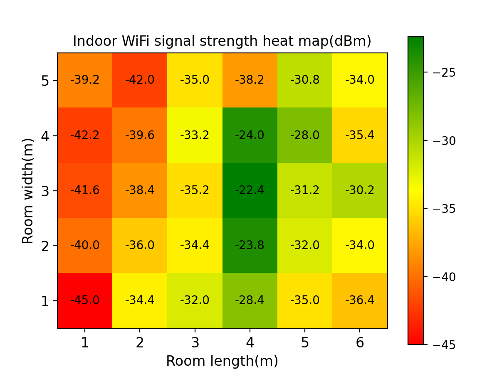
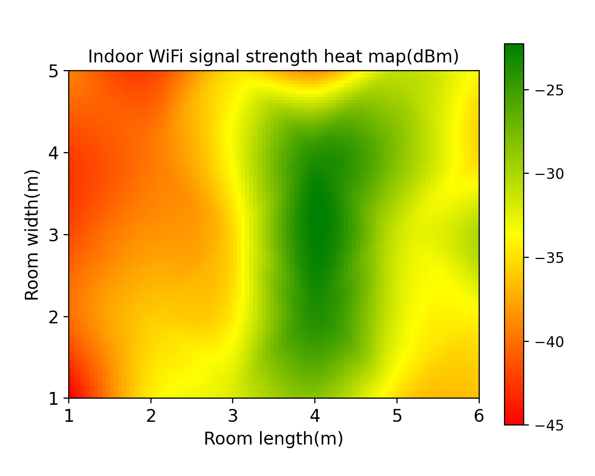
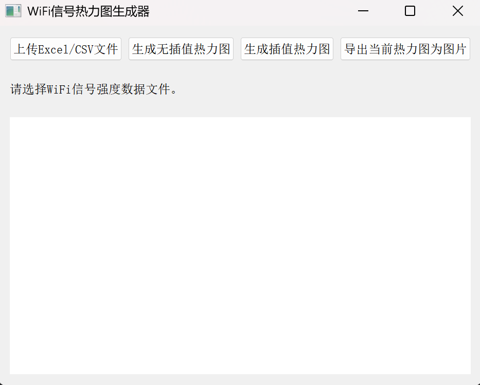
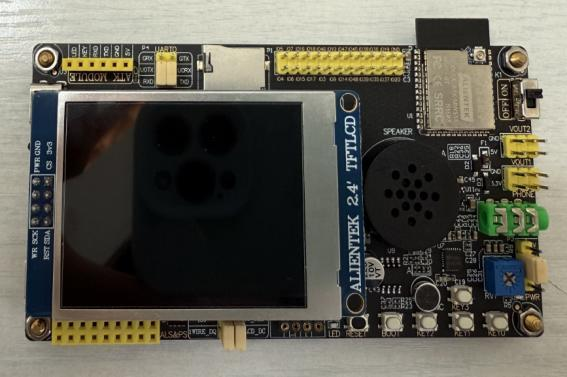
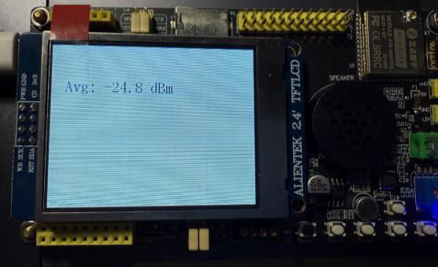

# 室内 Wi-Fi 信号强度映射系统

**Indoor Wi-Fi Signal Strength Mapping System**

基于 **ESP32-S3 + LCD + Python / PyQt5** 的毕业设计项目：从室内各测点采集 Wi-Fi RSSI，经串口记录和空间数据整理，生成原始网格热力图与三次插值热力图，用于观察室内无线覆盖的强弱分布。

**作者：石然冰（Shi Ranbing） · 2025 年本科毕业设计 · 电子与通信工程**

[快速体验](#快速体验无需硬件) · [硬件与采集](docs/SETUP.md) · [数据格式](docs/DATA_FORMAT.md) · [系统设计](docs/DESIGN.md) · [论文成果](docs/RESULTS.md)

## 项目效果

以下两张图直接提取自毕业论文，展示同一组 **5 行 × 6 列、共 30 个测点**的数据。

<table>
  <tr>
    <th>原始网格：查看各测点的 RSSI</th>
    <th>三次插值：观察空间变化趋势</th>
  </tr>
  <tr>
    <td></td>
    <td></td>
  </tr>
</table>

RSSI 单位为 dBm，数值越接近 0，信号越强。红、黄、绿表示当前图中从弱到强的相对变化；每张图的颜色范围自动计算。插值后的数值是估计值，不能代替现场测量。

## 完成了什么

| 模块 | 已实现功能 |
| --- | --- |
| 硬件采集 | DNESP32S3 连接指定 Wi-Fi，约每 1 秒读取一次 RSSI |
| 本地显示 | 约每 5 秒计算当前批次的平均值，并显示在 LCD 上 |
| 断线处理 | 进入采集循环后检测掉线、暂停采样，并每隔约 3 秒尝试重连 |
| 串口记录 | 以 115200 波特率接收 `RAW` / `AVG`，保存电脑时间、设备时间和 RSSI |
| 桌面绘图 | PyQt5 界面导入 `.xlsx` / `.csv`，绘制带数值标注的原始网格 |
| 插值与导出 | SciPy 二维三次插值至 100 × 100 网格；导出 PNG、JPG 或 PDF |

项目实现的是**指定网络采集 + 人工测点整理 + 离线热力图分析**。它可以辅助观察覆盖变化，但没有自动定位、实时地图更新或多频段扫描功能。

## 快速体验（无需硬件）

仓库附带一份从论文图 20 和图 30 人工转录并交叉核对的[示例数据](examples/report_grid.csv)，可直接用于桌面程序。它是论文展示矩阵的转录件，不是完整的原始串口实验记录。

以下命令适用于 Windows PowerShell，在仓库根目录执行：

```powershell
git clone https://github.com/ShiRanbing/Indoor-WiFi-strength-mapping-system.git
cd Indoor-WiFi-strength-mapping-system
python -m venv .venv
.\.venv\Scripts\python.exe -m pip install -r requirements.txt -i https://pypi.tuna.tsinghua.edu.cn/simple
.\.venv\Scripts\python.exe main.py
```

1. 点击 **上传Excel/CSV文件**，选择 `examples/report_grid.csv`。
2. 点击 **生成无插值热力图**，查看 30 个测点的数值。
3. 点击 **生成插值热力图**，查看平滑后的空间分布。
4. 点击 **导出当前热力图为图片**，选择路径并填写 `.png`、`.jpg` 或 `.pdf` 后缀。

依赖版本记录在 [requirements.txt](requirements.txt)。软件复核环境和未验证部分见[验证说明](docs/VALIDATION.md)。安装或使用遇到问题，可查看[常见问题](docs/SETUP.md#常见问题)。



## 从现场测量到热力图

1. **划分测点**：按等间距网格记录室内位置，确定 x、y 坐标和测量顺序。
2. **采集信号**：在测点停留，等待完整的采样批次；LCD 显示平均 RSSI。
3. **记录数据**：Python 串口脚本记录 `RAW` 和 `AVG` 数据，同时人工记录测点与时间的对应关系。
4. **整理矩阵**：按 y 行、x 列把各点的代表值填入 Excel 或 CSV。
5. **生成图像**：在桌面程序中导入矩阵，绘图、比较并导出。

**串口日志不能直接作为热力图输入。** 日志记录时间，热力图需要空间位置；两种格式和转换方法见[数据格式说明](docs/DATA_FORMAT.md)。

<table>
  <tr>
    <th>DNESP32S3 与 LCD</th>
    <th>现场平均 RSSI 显示</th>
  </tr>
  <tr>
    <td></td>
    <td></td>
  </tr>
</table>

具体板卡配置、LCD 引脚、固件上传和串口采集步骤见[硬件与使用指南](docs/SETUP.md)。

## 仓库结构

```text
.
├── main.py                        # PyQt5 桌面程序入口
├── wifi强度数据传输加Ave.py         # 原始串口采集与 CSV 记录脚本
├── 温度图.py                       # 早期原始网格绘图脚本
├── 温度图2.py                      # 早期插值绘图脚本
├── requirements.txt               # Python 直接依赖
├── firmware/
│   └── wifi_test_LCD/
│       ├── wifi_test_LCD.ino       # Arduino 固件入口
│       ├── wifi_config.example.h   # Wi-Fi 配置模板
│       ├── spilcd.cpp / spilcd.h   # SPI LCD 驱动
│       ├── xl9555.cpp / xl9555.h   # I/O 扩展驱动
│       └── font.h                 # LCD 字库
├── examples/
│   └── report_grid.csv             # 论文 30 个测点的矩阵转录
└── docs/
    ├── SETUP.md                    # 安装、硬件、采集和故障排查
    ├── DATA_FORMAT.md              # 串口日志与空间矩阵约定
    ├── DESIGN.md                   # 模块划分与实现细节
    ├── RESULTS.md                  # 论文成果、观察与局限
    ├── VALIDATION.md               # 本次软件复核记录
    ├── SOURCES.md                  # 论文图表与配套源码来源
    └── assets/                    # 从论文直接提取的原始图像
```

`main.py` 是推荐入口。两个“温度图”脚本保留早期实现，其中的 Excel 路径是原开发机器的绝对路径，使用前需要修改。原来位于根目录的 `.ino` 已移入与草图同名的文件夹，并补齐本地保留的驱动文件。

## 适用范围与后续方向

- 当前固件连接一个指定的 2.4 GHz Wi-Fi 网络，未实现 5 GHz 测量或多 AP 扫描。
- 测点坐标由人工记录；绘图按矩阵行列索引进行插值，适合等间距网格。
- 热力图展示 RSSI，未测量吞吐量、延迟、丢包或定位误差。
- 三次插值改善视觉连续性，但尚无独立验证集证明其估计精度。
- 可继续扩展测点标记、实时数据接入、缺失值校验和多种插值方法的误差比较。

## 论文与来源

石然冰，*《室内 WiFi 信号强度映射系统的设计与研究 / Design and Research of an Indoor WiFi Signal Strength Mapping System》*，北京交通大学兰卡斯特大学学院，电子与通信工程本科毕业设计，2025 年。

仓库文档结合论文和实际代码整理，图表出处及两者表述差异见[来源说明](docs/SOURCES.md)。本仓库尚未指定统一开源许可证；配套驱动的原有来源及权利归属应一并保留。
