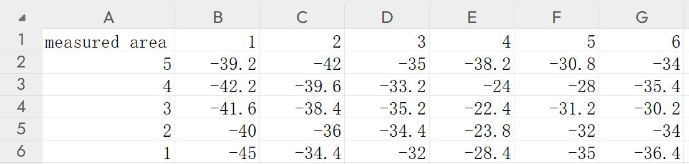

# 数据格式与测点整理

[返回项目首页](../README.md)

系统使用两类不同的表格：串口采集的**时间序列日志**，以及绘图需要的**空间网格矩阵**。它们不能直接互换，当前代码也没有自动完成位置标记和转换。

## 1. 设备串口协议

每条有效数据由三个逗号分隔的字段构成：

```text
数据类型,设备启动后的毫秒数,RSSI值
RAW,1000,-42
AVG,5000,-41.6
```

| 字段 | 说明 |
| --- | --- |
| `RAW` | 单次采样，程序按整数解析，单位 dBm |
| `AVG` | 当前批次平均值，程序按浮点数解析，固件输出一位小数 |
| 设备时间 | `millis()` 给出的设备运行时间；不等于电脑时间，也不是测点坐标 |

`WiFi Disconnected!`、`Attempting to reconnect...` 等是状态文本，不属于有效测量行。原始解析器会打印解析失败提示并跳过。

## 2. 电脑端 CSV 日志

`wifi强度数据传输加Ave.py` 按下面的列名追加写入 UTF-8 CSV：

```csv
PC Time,Data Type,ESP32 Timestamp (ms),RSSI (dBm),Average (dBm)
2025-05-01 10:00:01.000,RAW,1000,-42,
2025-05-01 10:00:05.000,AVG,5000,,-41.6
```

上面两条记录是**协议示意**，不是论文的原始实验日志。`RAW` 行只填写 `RSSI (dBm)`，`AVG` 行只填写 `Average (dBm)`；电脑时间来自接收数据时的 `datetime.now()`。

该文件没有 x/y 列。文件名、时间戳和信号强度本身无法恢复测点位置，因此不要把日志直接导入绘图界面。

## 3. 热力图输入矩阵

绘图界面支持 `.csv` 与 `.xlsx`，通过 Pandas 的 `index_col=0` 把第一列当作 y 标签，把第一行剩余表头当作 x 标签。其余单元格必须是数值型 RSSI。

仓库[示例矩阵](../examples/report_grid.csv)如下：

```csv
measured area,1,2,3,4,5,6
5,-39.2,-42,-35,-38.2,-30.8,-34
4,-42.2,-39.6,-33.2,-24,-28,-35.4
3,-41.6,-38.4,-35.2,-22.4,-31.2,-30.2
2,-40,-36,-34.4,-23.8,-32,-34
1,-45,-34.4,-32,-28.4,-35,-36.4
```

- 6 个数据列对应 x = 1…6，5 个数据行对应 y = 5…1。
- 数值单位统一为 dBm；单元格中不要加入 `dBm` 后缀。
- 第一条数据行显示在图像顶部。示例保留论文中从 y = 5 到 y = 1 的排列。
- Excel 应把矩阵放在第一个工作表，不要添加合并单元格、额外说明行或统计行。
- 当前实现不处理缺失值。至少提供 2 行 × 2 列的完整数值网格，避免退化为一条直线。
- 程序用连续行列索引进行插值，坐标标签只参与显示。因此应使用等间距测点；非均匀坐标不会被按真实距离处理。

## 4. 从日志整理成矩阵

1. 先规划等间距测点，固定坐标原点、方向、测量高度和设备朝向。
2. 每到一个位置，记录 x、y 和停留时段；等待采样批次不再包含移动过程中的读数。
3. 在对应时段内选取稳定的 `AVG` 值作为代表值。若采集多个批次，应记录选取或聚合规则，保持各测点规则一致。
4. 把代表值填到对应的 y 行、x 列，并保留完整日志与测点记录供核查。
5. 先绘制原始网格确认方向和数值，再生成插值图。

这是人工测点整理流程，不是现有程序自动执行的步骤。批次样本数可能不同，原日志也没有记录该数量；直接平均多个 `AVG` 不一定等价于对全部 `RAW` 样本求平均。

## 5. 示例数据的来源

`report_grid.csv` 从最终论文**图 20（数据整理表）**人工转录，并逐值对照**图 30（原始热力图）**核对，共 30 个值。原始电子表格和完整串口日志未包含在本次整理来源中，因此该文件只用于复现论文展示的数据与绘图流程。



原图与页码对应关系见[来源清单](SOURCES.md)。
