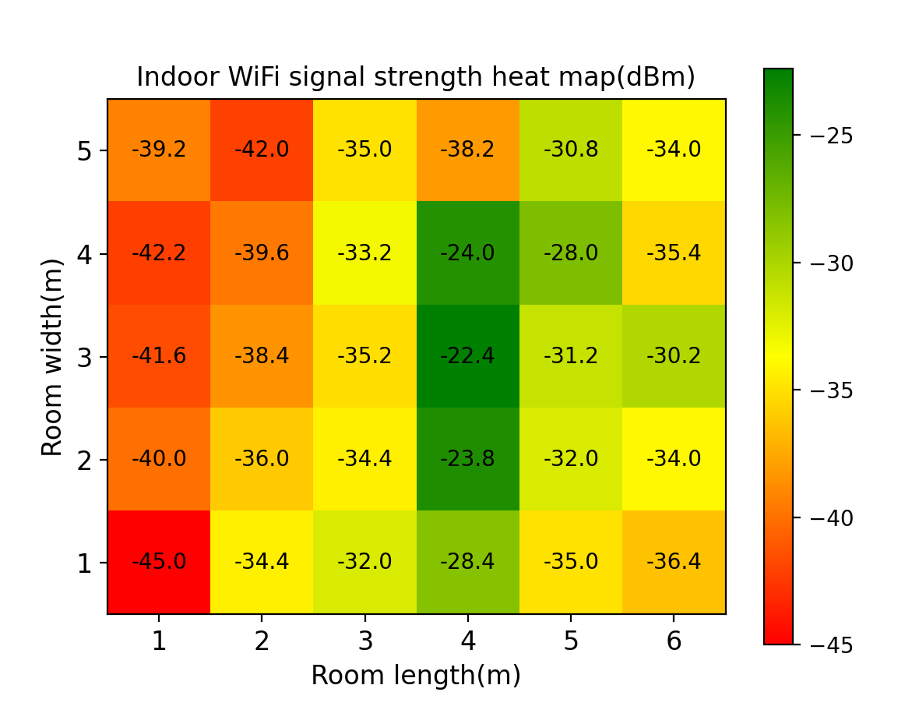
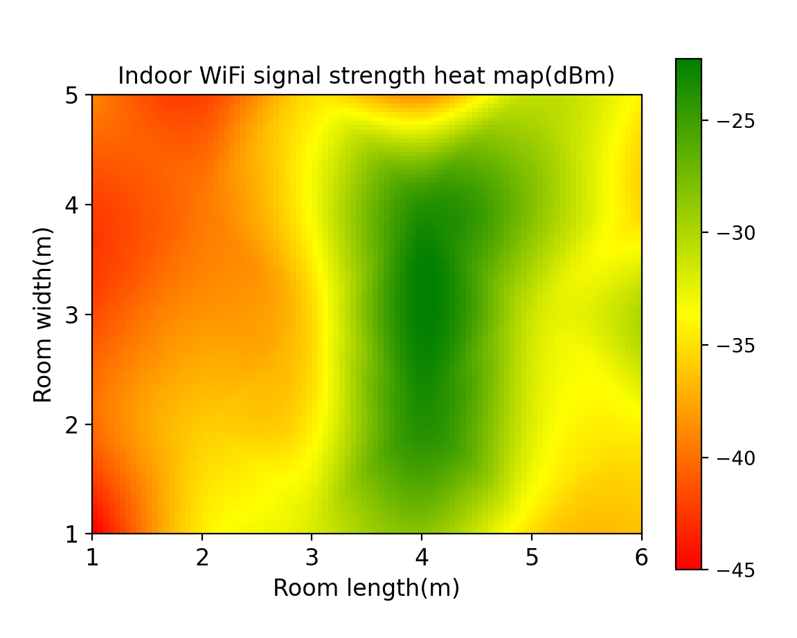

# 论文成果与适用范围

[返回项目首页](../README.md)

## 研究目标

以 ESP32-S3 和配套 LCD 构建室内 RSSI 测量终端，通过 Python 完成串口记录、空间数据可视化和桌面交互，帮助观察指定 Wi-Fi 网络在不同室内位置的强弱变化。

毕业论文完成于 2025 年，覆盖硬件平台、采集程序、串口记录、原始及插值热力图、桌面应用与后续改进方向。

## 展示数据

论文图 20 和图 30 给出 5 行 × 6 列的 30 个测点。根据该展示矩阵：

| 项目 | 数值 |
| --- | --- |
| 测点数量 | 30 |
| x 标签 | 1、2、3、4、5、6 |
| y 标签（文件顺序） | 5、4、3、2、1 |
| 最弱展示值 | -45.0 dBm，位于 x = 1、y = 1 |
| 最强展示值 | -22.4 dBm，位于 x = 4、y = 3 |
| 插值输出网格 | 100 × 100（由代码确定） |

这些是论文展示样本的描述，不能用于推断设备量程、测量精度或系统在所有环境中的表现。

### 原始网格

原图保留每个测点的数值，便于检查局部差异和核对数据。它适合回答“哪些位置采到了更强或更弱的信号”。

### 三次插值

插值图展示连续变化趋势。论文结合现场布置，对路由器附近的较强信号、墙体附近的变化和较远区域的衰减进行了定性讨论。这些解释依赖实验现场背景；算法本身没有输入墙体或路由器位置，不能据图自动识别障碍物。

### 桌面交互与硬件显示

论文还展示了文件选择、两种绘图、图像导出的 PyQt5 桌面界面，以及 LCD 上的平均 RSSI 读数。对应图片可在[项目首页](../README.md)查看。

## 能证明什么，仍缺少什么

展示材料支持以下结论：项目贯通了指定网络采集、串口记录、人工空间整理、热力图和桌面导出的流程；同一组数据可以分别呈现离散测点与插值趋势。

论文没有提供独立验证集上的 MAE / RMSE、与标准仪器的校准对比、吞吐量对照或定位精度测试。因此，本项目不声称“插值提高了测量精度”或给出未验证的准确率。

当前主要局限：

1. 人工记录位置和整理矩阵，无法实时动态更新整幅地图。
2. RSSI 会受到多径、人员活动和设备朝向等因素影响，单次测量未必能代表长期覆盖。
3. 插值图中的未测位置是估计值，不能恢复真实障碍物边界。
4. 当前板卡与固件只覆盖指定的 2.4 GHz 网络；未实现多频段、多 AP 采集。
5. 原始完整串口记录未纳入仓库，示例 CSV 来自论文矩阵转录。

## 可继续推进的方向

- 在采集界面加入测点坐标与批次标记，减少人工转换。
- 保存每批样本数、设备信息和测量条件，便于复核。
- 增加输入校验、固定色标和缺失点处理。
- 用留出测点比较 nearest、linear、cubic 等方法的估计误差。
- 在明确坐标来源后接入实时绘图；扩展频段需要相应硬件支持。

以上内容属于后续方向，当前仓库未实现。
